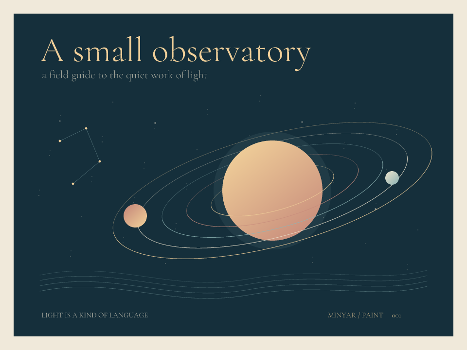

# A small observatory



An external package becomes a little studio. `paint` draws the same paths into
an antialiased PNG and an editable SVG. The consumer combines a choice of
atmosphere, a record method, a generic ink selector and interpolated Text.
TrueType outlines supply the lettering.

After `paint` is published:

```sh
minyar add github.com/O4FDev/paint@v0.1.0
PAINT_FONT="/absolute/path/to/a/font.ttf"
minyar run --locked -- "$PAINT_FONT"
minyar run --release --locked --offline -- "$PAINT_FONT"
```

Before publication, use the [private mirror setup](../paint/README.md).
The preview uses the unmodified `assets/CormorantGaramond.ttf` in the separate
`minyar-paint` repository, under its OFL license. Supply that path to reproduce
the preview, or choose another supported TrueType font to change its lettering.
The font is a runtime input; it is not part of this project's source lock.

The program writes `observatory.png` and `observatory.svg`, then prints:

```text
observatory · paint v0.1.0 · 960 × 720
```

`make check-paint-package MINYAR_PAINT_SOURCE="/path/to/minyar-paint"` checks
this picture and first light in both debug and release profiles after removing
their private Git host. It independently decodes PNG pixels and checks the
gallery's expected output.
